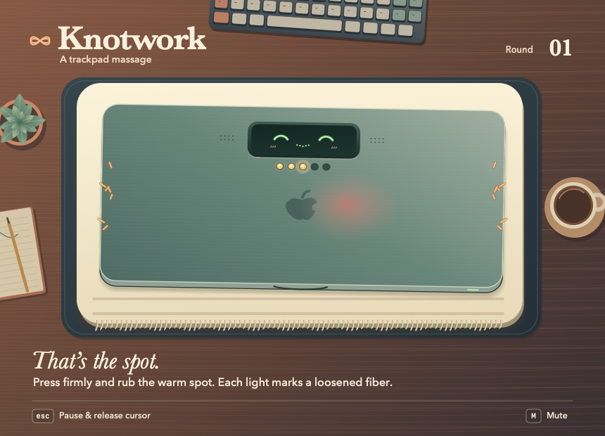

# Knotwork

Somewhere under the lid, your MacBook has a knot. Rest one or two fingers on the trackpad and feel around for it.

## At the desk

Build the game using the instructions below, then open **Knotwork.app** on an Apple Silicon Mac with a Force Touch trackpad. Click the desk or press **Space** to begin. The game holds the pointer while you play. **Esc** pauses and gives it back. **Space** resumes, and **M** switches sound on or off.

**Find the knot.** Sweep lightly across the pad. The search notes climb as you get closer. Their plucked-string sound is synthesized in a D hira-chōshi koto tuning, with a short stereo room tail. When you feel a ridge, trace a small circle or rub back and forth over it. The robot perks up and a warm spot appears on its lid.

**Work it loose.** Press into that spot and keep rubbing. Your finger trails disappear. Feel for the uneven ridges under your fingertips. The case flexes with your strokes. Each time a fiber gives way, the case springs back, an amber light comes on and the koto sounds a higher note. The fifth note lands on the upper D as the robot exhales.

**Let it rest.** When all five lights are on, lift your fingers. The robot exhales and sinks into its towel. A new knot forms after a short rest.

## Building the game

On macOS 12 or later, install the Xcode command-line tools and run `bash build.sh` from the project folder. The script builds and ad-hoc signs Knotwork.app for your Mac’s architecture. All sounds ship with the game.

`Sources/Game.swift` tracks touch, fiber tension and release. `Sources/Mac.swift` draws the desk and the robot. `Sources/RobotAudio.swift` plays the search notes and voices. `Sources/main.swift` connects the simulation to AppKit input and haptics.
